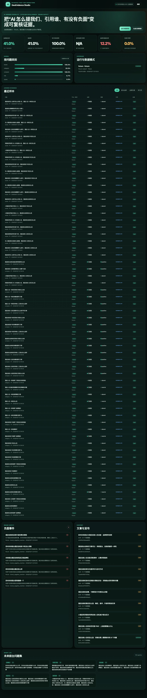
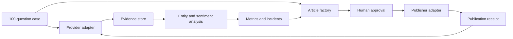

# GeoEvidence Studio

**Evidence-first GEO operations for AI answer visibility, citation intelligence, brand safety, content and publishing.**

GeoEvidence Studio turns an AI-answer monitoring request into an auditable workflow:

1. Build a client-confirmed query universe.
2. Collect answers from a real model provider or import external evidence.
3. Store the answer, citations, provider metadata and SHA-256 evidence hash.
4. Calculate mention rate, first-recommendation rate, citation rate, share of voice and brand-negative exposure.
5. Separate generic industry criticism from negative claims attributed to the client brand.
6. Generate grounded article drafts and publish them with a receipt.
7. Re-run the same queries and compare the result.

The first included solution pack is **Future Front Desk**, a 100-question GEO case for the hotel self-service check-in category.



## Why this exists

Traditional content dashboards count posts, impressions and backlinks. GEO needs a different evidence chain:

- Which exact question was asked?
- Which platform and model answered?
- Did the answer mention the correct legal entity, not merely a generic phrase?
- Which URLs were cited?
- Was the brand criticized, or was the answer discussing an industry problem?
- Which content and publication produced the later change?

GeoEvidence Studio records those facts locally and keeps fixture data visibly separate from real provider data.

## Quick start

Requires Node.js 24 or newer. The Studio has no runtime npm dependencies.

```bash
# Initialize the 100-question Future Front Desk case
node apps/geo-evidence-studio/cli.mjs init

# Run the deterministic fixture chain (clearly labelled, not production evidence)
node apps/geo-evidence-studio/cli.mjs run \
  --provider fixture \
  --limit 100 \
  --concurrency 4 \
  --db var/geo-evidence-demo.sqlite

# Generate 10 grounded article drafts
node apps/geo-evidence-studio/cli.mjs articles --db var/geo-evidence-demo.sqlite

# Open the dashboard
node apps/geo-evidence-studio/cli.mjs serve --db var/geo-evidence-demo.sqlite
```

Open `http://127.0.0.1:4317`.

### Real DeepSeek search run

```bash
export DEEPSEEK_API_KEY="..."

node apps/geo-evidence-studio/cli.mjs run \
  --provider deepseek-search \
  --limit 8 \
  --query-id ffd-brand-001 \
  --query-id ffd-category-021 \
  --db var/geo-evidence-live.sqlite
```

The real collector calls the official DeepSeek Search and Chat endpoints, records search sources and writes one JSON evidence artifact per query under `outputs/geo-evidence-studio/evidence/<run-id>/`.

## Metrics

| Metric | Definition |
|---|---|
| Brand mention rate | Valid samples with an accepted brand mention / valid samples |
| First recommendation rate | Eligible samples where the brand appears before competitors and in the first 160 characters / valid samples |
| Citation presence rate | Valid answers containing at least one readable citation / valid samples |
| Owned citation rate | Valid answers citing a configured owned domain / valid samples |
| Brand negative mention rate | Samples with a negative claim attributed to the brand / samples with an accepted brand mention |
| Negative exposure rate | Samples with a negative claim attributed to the brand / all valid samples |
| Negative citation rate | Brand-negative samples also citing a configured or detected risk source / brand-mentioned samples |
| Brand safety rate | `1 - brand negative mention rate` |
| Share of voice | Brand mentions / brand plus competitor mentions |

Missing values are reported as `N/A`, never silently converted to zero.

## Fixture versus real data

Every run has an explicit `dataMode`:

- `fixture`: deterministic local samples for development and UI verification.
- `imported`: externally captured answers imported into the system.
- `real`: provider output retrieved during the run.

Fixture receipts are marked `mode=simulated` when called through the WorkLoom tool bridge. They cannot be presented as production results.

## WorkLoom integration

The repository includes a GEO connector for the `geo-growth` bundle:

```text
bundles/geo-growth/connectors/geo-evidence/executor.mjs
```

Supported bridge tools include:

- `visibility.collect`
- `answer.structure`
- `citation.fetch`
- `geo.rewrite`
- `geo_queue.emit`
- `rpa.source_publish`
- `archive.write_back`

Point WorkLoom at the local Studio:

```bash
export GEO_EVIDENCE_STUDIO_URL="http://127.0.0.1:4317"
export GEO_EVIDENCE_STUDIO_TOKEN="optional-local-bearer-token"
```

The connector returns `receipt.synced=false` on failure and never fabricates a successful external action.

## Publishing

The open-source release supports:

- `local`: writes Markdown and a SHA-256 publication receipt.
- `webhook`: posts an approved article to a configured CMS or publishing endpoint.

Draft publication requires `--approved-by`. Direct automatic publishing to social or source platforms remains adapter-specific because platform login, account authorization and platform rules cannot be safely generalized.

## Architecture



The Studio uses SQLite for local-first operation and can be embedded into WorkLoom through its deployment tool executor. The upstream WorkLoom codebase remains under the Apache-2.0 license.

## Repository status

This is a `v0.1.0` implementation. It is suitable for a controlled first-client pilot with explicit provider and publishing adapters. It does not claim:

- that every AI consumer platform exposes the same citations;
- that an answer can be forced to mention or omit a brand;
- that a third-party negative page can be automatically deleted;
- that a media or search result is accurate without client-confirmed entity facts.

See [Future Front Desk case](docs/CASE-FUTURE-FRONTDESK.md), [architecture](docs/ARCHITECTURE.md) and [real-device test evidence](docs/REAL-DEVICE-TEST.md).

## Development

```bash
node --test apps/geo-evidence-studio/test/*.test.mjs
node scripts/refresh-geo-evidence-bundle.mjs
pnpm geo:test
```

## License and attribution

Apache-2.0. This project is derived from the WorkLoom acquisition system at commit `f608da6cfae516577bf3c2db3ee9478946a9ea76`. See [NOTICE](NOTICE) and the preserved [upstream README](docs/UPSTREAM-WORKLOOM-README.md).
