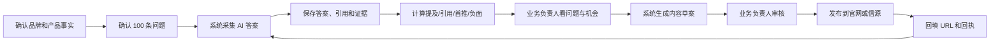

# GeoEvidence Studio

**把“AI 有没有提到我们、引用了谁、有没有负面”变成一套可复核、可复盘、可持续优化的 GEO 经营系统。**

[English README](README.en.md) · [客户业务负责人使用指南](docs/客户业务负责人使用指南.md) · [未来前台实施方案](docs/未来前台客户交付方案.md)


## 先用一句话讲清楚

你提供品牌事实、产品资料、竞品和发布账号；系统按你确认的问题持续去问 AI，保存答案和引用证据，算出提及率、引用率和品牌负面率，再把发现变成文章选题和纠偏动作，最后复测同一批问题，确认经营动作有没有效果。

这不是一个“自动刷排名”的工具，也不是一个只统计发稿数量的内容后台。它解决的是：

- AI 到底有没有提到你的品牌；
- 提的是不是你这家公司，而不是同名品牌或泛词；
- AI 引用了谁，为什么没有引用你的官方内容；
- 负面问题是在批评整个行业，还是已经指向你的品牌；
- 发布内容后，AI 答案和引用来源有没有真实变化。

## 一、客户业务负责人要做什么

业务负责人不需要操作代码，但必须做四类经营决策。

### 1. 给系统一套可信的事实底座

确认并向系统提供：

- 法定公司名称和品牌别名；
- 官方域名和允许引用的页面；
- 产品名称、型号、参数、适用和不适用场景；
- 价格逻辑、资质、售后 SLA；
- 竞品名单；
- 不允许使用的表达和可能产生安全风险的说法。

事实没确认之前，系统只生成“待确认草案”，不会把搜索结果或模型猜测写成客户官方口径。

### 2. 确认问题集

系统已经内置 100 条未来前台问题：

| 类别 | 数量 | 业务用途 |
|---|---:|---|
| 品牌确认 | 20 | AI 是否认识公司、品牌和产品 |
| 品类选购 | 25 | 酒店自助机怎么选、哪家好 |
| 使用场景 | 25 | 小酒店、民宿、PMS、无人值守 |
| 竞品对比 | 15 | 竞品、传统前台和其他方案 |
| 负面与风险 | 15 | 故障、隐私、售后和负面问题 |

业务负责人需要逐条确认这些问题是否符合真实客户语言、是否漏掉重点产品和场景。

### 3. 决定负面问题怎么处理

当系统发现品牌负面时，业务负责人决定：

- 是错误事实、过时信息、竞品干扰，还是真实服务问题；
- 由哪个部门负责；
- 是发布事实页、更正稿、售后说明，还是线下处理；
- 修复后是否安排同题复测。

系统不能删除第三方内容，也不能承诺负面率归零。它负责发现、留证、归因、提醒和复测。

### 4. 审核内容与公开发布

业务负责人或授权审批人需要确认：

- 文章是否代表客户官方口径；
- 产品参数和案例是否真实；
- 是否涉及品牌表态；
- 发布到哪个信源；
- 发布后是否把 URL 和页面回执回填系统。

高风险、涉品牌表态和公网发布不能绕过人工审批。

## 二、系统替客户做什么

| 工作 | 系统负责 | 业务负责人负责 |
|---|---|---|
| 品牌事实 | 结构化、冲突提示、版本记录 | 确认事实是否真实 |
| 问题集 | 生成、分类、优先级、风险标记 | 确认客户语言和重点 |
| AI 答案采集 | 调用模型、保存答案/引用/Hash | 授权平台和账号 |
| 品牌识别 | 实体别名和上下文消歧 | 处理无法判断的边界样本 |
| 指标计算 | 提及、引用、首推、SOV、负面率 | 确认指标口径和经营目标 |
| 负面分析 | 区分行业负面与品牌负面 | 决定纠偏责任和动作 |
| 文章生产 | 按主题生成有事实边界的草案 | 审核和授权公开发布 |
| 发布回执 | 保存平台 URL、内容 Hash、回执 | 提供账号或 CMS |
| 复盘 | 同题复测、趋势和样本下钻 | 决定下一轮经营动作 |

## 三、基础业务闭环



这条闭环每周重复一次，月度做趋势复盘。

## 四、客户实际会得到什么

### 首次启动后

- 一份未来前台 AI 能见度基线；
- 100 条待确认问题集；
- 各问题的答案、引用和证据记录；
- 品牌提及率、引用率和负面率；
- 品牌负面问题清单；
- 10 类内容主题和文章草案；
- 至少一条本地或 webhook 发布回执。

### 每周

- 新出现问题、竞品占位和引用来源机会；
- 品牌负面与事实冲突告警；
- 待审核内容；
- 发布后变化；
- 下周建议动作。

### 每月

- 平台和问题类别趋势；
- 提及率、引用率和 SOV 变化；
- 负面闭环率；
- 内容发布与引用增量；
- 需要补充的官网/信源页面。

## 五、业务负责人怎么开会

### 首次启动会，约 60 分钟

1. 确认公司和品牌名称。
2. 确认官网域名和产品资料。
3. 确认竞品和禁用表达。
4. 逐类确认 100 条问题。
5. 确认目标平台和发布账号。
6. 指定内容审核人与负面事件负责人。

### 每周经营会，约 30 分钟

1. 看六个核心指标。
2. 处理 P0/P1 品牌负面。
3. 看竞品和引用来源变化。
4. 审核 1–3 篇内容。
5. 确认本周发布动作。

### 每月复盘，约 60 分钟

1. 看趋势，不看单点数字。
2. 判断哪些页面真正带来引用。
3. 判断哪些问题需要补内容或补事实。
4. 调整下一月问题优先级。
5. 决定是否扩展到更多平台和信源。

## 六、当前 v0.1.0 的真实能力

### 已经跑通

- 未来前台 100 条问题集；
- DeepSeek Search + Chat 真实采集；
- 原始回答、引用、模型信息和 SHA-256 证据；
- 品牌提及、首推、引用、SOV 和品牌负面指标；
- 行业负面与品牌负面分离；
- 对“无法判断/缺少证据”的误报过滤；
- 10 类文章草案；
- 本地发布和 webhook 发布回执；
- WorkLoom GEO 工具桥；
- 桌面和移动端看板；
- Chrome 真机走查与 GitHub CI。

### 当前适合的交付方式

当前是单客户试点版，适合：

- 先跑 DeepSeek 真实基线和后续复测；
- 其他平台先人工采集后导入；
- 先由客户审核并人工发布到官网或内容平台；
- 用本地 SQLite 和独立实例完成试点。

### 还需要接入

- 豆包、元宝、Kimi、通义等其他平台自动采集；
- 每条 AI 回答的浏览器截图/DOM 存证；
- 客户官网 CMS 和知乎/公众号等真实发布适配器；
- 自动定时任务；
- PostgreSQL 多租户和 RLS；
- 更完整的负面事件结案与复测状态；
- 引用位占比、来源机会和内容归因趋势。

## 七、项目快速启动

要求 Node.js 24 或更高版本。当前 Studio 本身不依赖额外 npm 运行时包。

```bash
# 初始化未来前台 100 条问题
node apps/geo-evidence-studio/cli.mjs init

# 运行完整夹具链路，验证看板和指标
node apps/geo-evidence-studio/cli.mjs run \
  --provider fixture \
  --limit 100 \
  --concurrency 4 \
  --db var/geo-evidence-demo.sqlite

# 生成 10 篇文章草案
node apps/geo-evidence-studio/cli.mjs articles \
  --db var/geo-evidence-demo.sqlite

# 打开系统
node apps/geo-evidence-studio/cli.mjs serve \
  --db var/geo-evidence-demo.sqlite
```

打开：`http://127.0.0.1:4317`

### 真实 DeepSeek 采集

```bash
# 先在当前 shell 中安全设置 DEEPSEEK_API_KEY，不要把密钥写进仓库
export DEEPSEEK_API_KEY

node apps/geo-evidence-studio/cli.mjs run \
  --provider deepseek-search \
  --limit 8 \
  --query-id ffd-brand-001 \
  --query-id ffd-category-021 \
  --db var/geo-evidence-live.sqlite
```

凭据只通过环境变量读取，不写入数据库、证据或日志。

## 八、指标怎么看

| 指标 | 客户怎么理解 |
|---|---|
| 品牌提及率 | AI 回答里出现正确品牌的比例 |
| 首推率 | 品牌较早出现且未被竞品先占位的比例 |
| 有引用回答率 | AI 有没有给出可追溯来源 |
| 自有信源引用率 | 被引用的是不是客户自己的官网/页面 |
| SOV | 品牌声量占品牌与竞品总声量的比例 |
| 品牌负面率 | 在提到品牌的回答中，有多少把负面问题指向品牌 |
| 负面引用率 | 品牌负面是否伴随即风险来源 |
| 证据覆盖率 | 成功样本中有没有可复核证据 |

没有配置官网域名时，“自有信源引用率”显示 N/A；没有配置竞品时，SOV 显示 N/A。N/A 不是 0。

## 九、文章和发布

系统当前提供 10 个主题草案：

1. 酒店自助入住机选型指南；
2. 小酒店和民宿降前台压力；
3. PMS 对接；
4. 身份证核验与隐私安全；
5. 故障排查；
6. 售后体系；
7. 前台方案对比；
8. 采购与验收；
9. 负面问题回应；
10. 品牌资料说明。

内容发布前必须确认：

- 事实来自客户确认实体卡；
- 不虚构参数、价格、认证、销量和客户案例；
- 经过业务负责人审核；
- 保存发布 URL、内容 Hash 和页面回执。

当前支持：

- 本地 Markdown 发布；
- 通用 webhook 发布。

知乎、公众号、官网 CMS 的真实发布适配器仍按客户账号逐项接入。

## 十、WorkLoom 集成

项目内置 WorkLoom `geo-growth` 工具连接器：

```text
bundles/geo-growth/connectors/geo-evidence/executor.mjs
```

支持：

- `visibility.collect`
- `answer.structure`
- `citation.fetch`
- `geo.rewrite`
- `geo_queue.emit`
- `rpa.source_publish`
- `archive.write_back`

配置：

```bash
export GEO_EVIDENCE_STUDIO_URL="http://127.0.0.1:4317"
export GEO_EVIDENCE_STUDIO_TOKEN="可选的本地访问令牌"
```

工具失败时返回 `receipt.synced=false`，不会伪造成功回执。

## 十一、项目目录

```text
apps/geo-evidence-studio/
  cli.mjs                 CLI
  server.mjs              HTTP 服务和静态看板
  lib/core.mjs            问题集、实体、指标、文章
  lib/providers.mjs       DeepSeek / 夹具 / 导入采集
  lib/service.mjs         采集、重分析、生成、发布
  lib/store.mjs           SQLite 数据层
  public/                 中文业务看板

bundles/geo-growth/
  connectors/geo-evidence/executor.mjs

docs/
  客户业务负责人使用指南.md
  CASE-FUTURE-FRONTDESK.md
  ARCHITECTURE.md
  REAL-DEVICE-TEST.md
```

## 十二、当前验证结果

- 自动测试：11/11 通过；
- 100 条夹具链路：100/100 成功；
- 证据覆盖率：100%；
- 真实 DeepSeek：8/8 成功；
- 真实品牌提及率：37.5%；
- 真实有引用回答率：100%；
- 品牌负面误报测试：已覆盖并修复；
- Google Chrome 桌面与移动端：无控制台错误、无横向溢出；
- GitHub Actions：成功。

详细证据见 [真机测试记录](docs/REAL-DEVICE-TEST.md)。

## 十三、边界

本系统不承诺：

- 强制 AI 提及某个品牌；
- 保证某个品牌永远不出现负面；
- 自动删除第三方负面页面；
- 所有平台都能拿到相同引用字段；
- 未经客户确认的事实可以自动发布。

系统能承诺的是：每一次采集、每一个指标、每一条负面和每一次发布，都有来源、时间、版本和回执可查。

## 十四、开源与归属

Apache-2.0。

本项目源自 WorkLoom：

- 上游：`workloom-ai/workloom`
- 上游提交：`f608da6cfae516577bf3c2db3ee9478946a9ea76`

WorkLoom 原始 README 保留在 [docs/UPSTREAM-WORKLOOM-README.md](docs/UPSTREAM-WORKLOOM-README.md)，上游 CNB/桌面发布 workflows 保留在 `docs/upstream-workflows/`。
