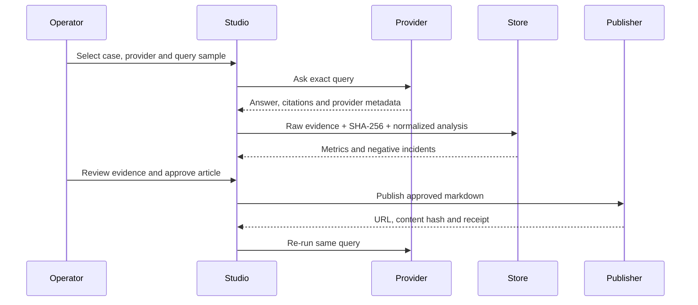

# Architecture

## Scope

GeoEvidence Studio is the first production-shaped vertical application built on the formal `workloom` acquisition repository.

It separates three concerns:

1. **Shared platform**: identity, work areas, approvals, events, fences and bundle installation remain WorkLoom responsibilities.
2. **Reusable GEO product**: query design, answer collection, evidence, metrics, brand safety and content are provided by `apps/geo-evidence-studio`.
3. **Client pack**: Future Front Desk supplies its query universe, entity aliases and case-specific thresholds without forking the platform.

## Data flow

## Entity safety

“未来前台” is a generic Chinese phrase. A short alias is accepted only when surrounding text contains context such as:

- 苏州 / 昆山 / 花桥
- 酒店 / 自助 / 入住 / 发卡
- AI / 智慧 / 品牌 / 公司 / 售后

The full legal entity alias is accepted directly but remains marked unconfirmed until the client supplies business-license evidence.

## Negative safety

The system stores two distinct concepts:

- `industryNegative`: the answer criticizes the category but not the brand.
- `brandNegative`: a negative sentence contains an accepted brand mention.

Only `brandNegative` enters the brand-negative numerator. This prevents the exact failure mode in which an industry complaint is incorrectly attributed to the client.

## Tool bridge

WorkLoom loads `bundles/geo-growth/connectors/geo-evidence/executor.mjs` through its deployment tool executor seam.

The bridge:

- routes declared GEO tools to the local Studio HTTP API;
- forwards WorkLoom tenant/workspace scope;
- distinguishes real from simulated data;
- returns `synced=false` on failure.

## Production evolution

The local SQLite schema is intentionally small. A multi-client deployment can keep the same API and swap the store for PostgreSQL with tenant/workspace RLS. Query sets, entity cards and provider credentials should remain tenant data, not source-code forks.
